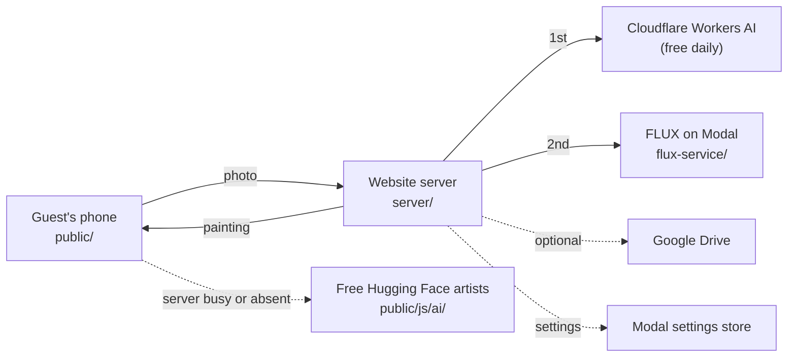

# How it fits together

Three parts, each in its own folder:

| Folder | What it is | Runs on |
|---|---|---|
| `public/` | The pages guests and hosts see (plain HTML, CSS, JavaScript modules; no build step) | The guest's phone |
| `server/` | A small Node.js server: serves `public/`, keeps the keys secret, talks to the AI engines | Render |
| `flux-service/` | The FLUX painter, upscaler and settings store | Modal (cloud GPU) |



## A portrait, step by step

1. **Phone** (`public/js/flows/photoInput.js`): camera or library → `media/photo.js` resizes to 1536 px, plus a <512 px copy for Cloudflare.
2. **Phone** checks the photo (`media/photoCheck.js`: dark, bright, blurry, no face) and shows gentle tips. Then (`flows/portrait.js`) it posts the photo and chosen background to `/api/generate` and polls `/api/queue` for "You're 3rd in line".
3. **Server** (`routes/generate.js`): checks the photo, studio switch, daily cap and limits (per phone and per address), then waits its turn in `lib/queue.js`.
4. **Server** (`engines/chain.js`) tries each engine in order: `engines/cloudflare.js`, then `engines/flux.js`. One that is out of allowance, failing or busy is skipped and rested.
5. Small paintings are doubled by `engines/upscaler.js` (optional).
6. **Phone** lays out the keepsake on a canvas (`portrait/compose.js`, with today's date), reveals it with a watercolour wash, shows the before/after slider and sends the keepsake to Drive (`services/siteSettings.js` → `/api/keepsake`, only with a one-time ticket).
7. If the server has no artist free (or there is no server, as on GitHub Pages), the phone asks the free FLUX Kontext Spaces on Hugging Face in turn (`ai/huggingFace.js`, list in `ai/spaces.js`). If all are busy, the guest is asked to try again; their photo and words are kept.

## Server (`server/`)

```
index.js         starts the server
app.js           security headers → router → files from public/
services.js      builds every part from config.js (engines, queue, limits, storage…)
router.js        table of every /api address → its handler
config.js        reads all settings from environment variables
routes/          one file per address group: generate, queue, keepsake, admin, info, count (today's keepsake count)
engines/         AI engines: cloudflare, flux, gemini/, chain (order + fallback), upscaler; styles.js re-exports public/js/ai/styles.js
storage/         settings store, Google Drive, Modal settings backup
lib/             small shared helpers: http, static files, queue, limits, tickets, sessions, logbook…
assets/          test photo for the wedding-day test
```

Rule of thumb: **routes** handle one web request, **engines** paint, **storage** keeps things, **lib** is generic and knows nothing about weddings.

## Guest page (`public/js/`)

```
main.js          maps each data-action="…" button to a function
config.js        wedding names, frame/monogram files, timings
state.js         the current guest's name, message, photo
flows/           what happens when a guest does something: navigation, photoInput, portrait, form
services/        talking to the server and saving: api, siteSettings, drafts, share, todayCount
media/           camera, photo handling and the photo check
ui/              screen helpers (dom), before/after slider, background dots, language switcher, larger text, today's count, your frame/monogram
portrait/        drawing the keepsake on a canvas (layout, shapes, text wrapping)
ai/              styles (the AI instructions) and the free Hugging Face artists
i18n/            every word guests see, in English, Gujarati and Hindi
```

Other pages: `public/admin/` (hosts' admin page), `public/sign/` (printable QR sign), `public/sw.js` (offline support).

## Words used in the code

| Word | Means |
|---|---|
| engine (also "provider") | An AI service that paints: Cloudflare, FLUX, Gemini |
| chain | Trying engines in order and skipping ones that can't paint right now |
| style / style variant | One of the prompts in `public/js/ai/styles.js` (default: "Wedding caricature") |
| background | The guest's colour choice; `BACKGROUND` in a prompt is replaced with it |
| free artists / Spaces | Public FLUX Kontext demos on Hugging Face, asked from the guest's phone when the server has no artist (`public/js/ai/`) |
| studio open | The admin switch: off = guests' phones use the free artists |
| ticket | One-time pass that lets a finished keepsake be uploaded to Drive |
